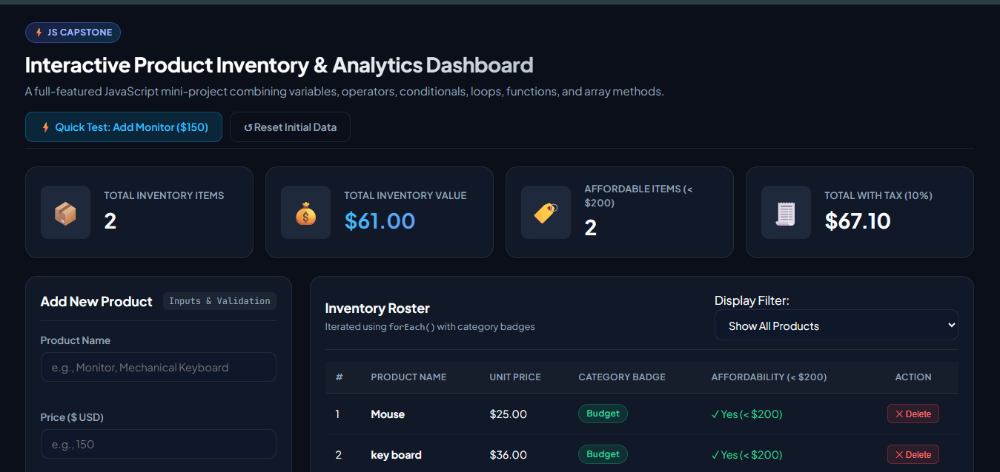
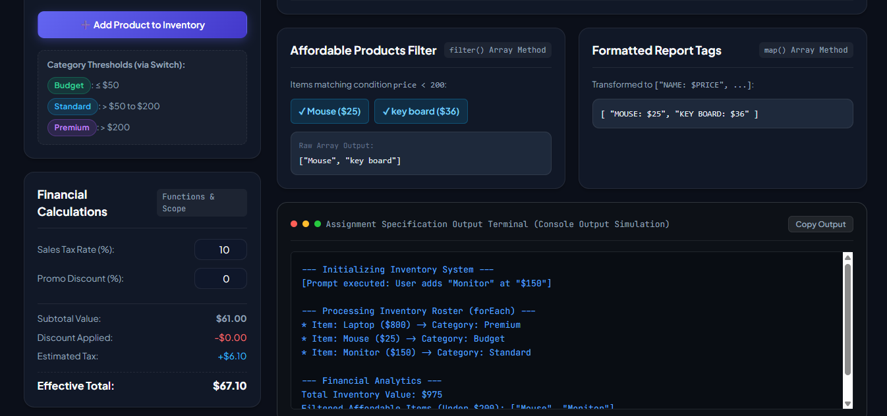
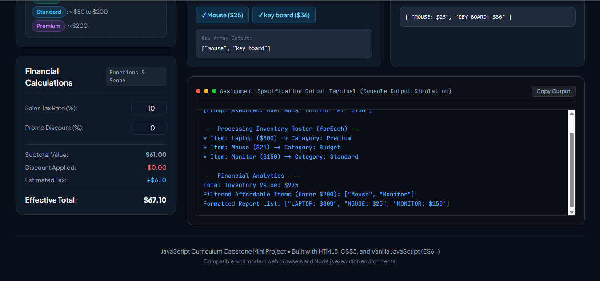

# JavaScript Internship Assignments & Capstone Project

A comprehensive, production-grade repository containing all six curriculum exercises and the final interactive capstone dashboard project as specified in the **JavaScript Curriculum: Student Assignments & Capstone Project** guide.

---

## 📌 Project Overview

This repository demonstrates modern core JavaScript (ES6+) principles through hands-on practical exercises and an interactive browser-based product inventory and analytics dashboard.

### Core Competencies Demonstrated:
- **Assignment 1:** Variable declaration rules (`var`, `let`, `const`), primitive & reference data types, type checking with `typeof`, and console inspection.
- **Assignment 2:** Mathematical and assignment operators (`*`, `/`, `+=`), browser input via `prompt()`, explicit type coercion using `Number()`, and formatted financial calculations.
- **Assignment 3:** Multi-branch conditional branching (`if...else`), multi-case evaluation using `switch`, and compact decision logic using the ternary operator (`? :`).
- **Assignment 4:** Iterative control structures (`for`, `while`, `do...while`) and jump statements (`break` for early exit, `continue` for skipping iterations).
- **Assignment 5:** Function architecture, regular function declarations, concise arrow functions (`=>`), default parameters, return statements, and block vs. function variable scope.
- **Assignment 6:** Array of objects data structures, declarative traversal with `forEach()`, predicate-based filtering with `filter()`, and array transformation with `map()`.
- **Capstone Mini Project:** An interactive, responsive, glassmorphic **Product Inventory & Analytics Dashboard** incorporating dynamic product additions, input sanitization and validation, category classification, live financial modeling with configurable tax and discount parameters, and real-time terminal output simulation.

---

## 🛠️ Technologies Used

- **HTML5:** Semantic markup, accessibility attributes (`aria-live`, `role="alert"`), responsive layout structure.
- **CSS3:** Custom design system without third-party frameworks, CSS custom properties (variables), modern Flexbox and CSS Grid, dark glassmorphism aesthetic, typography via Google Fonts (*Plus Jakarta Sans* & *JetBrains Mono*).
- **Vanilla JavaScript (ES6+):** Pure JavaScript without external libraries, using modern array methods, arrow functions, template literals, and DOM event handling.
- **Node.js:** Automated test runner and headless execution support.

---

## 📁 Repository Structure

```text
javascript-internship/
├── assignments/
│   ├── assignment-01-variables.js
│   ├── assignment-02-operators.js
│   ├── assignment-03-conditions.js
│   ├── assignment-04-loops.js
│   ├── assignment-05-functions.js
│   └── assignment-06-arrays-objects.js
├── capstone/
│   ├── index.html
│   ├── style.css
│   └── script.js
├── screenshots/
│   └── README.md
├── test-runner.js
└── README.md
```

---

## 📚 Assignment Descriptions & Concepts

### Assignment 1: Variables, Data Types, and Console Operations
* **File:** `assignments/assignment-01-variables.js`
* **Concepts:** Variable scoping (`var` function-scoped, `let` and `const` block-scoped), data types (`string`, `number`, `boolean`, `object`), and `typeof` evaluation.
* **Execution:** `node assignments/assignment-01-variables.js`
* **Expected Output:**
  ```text
  Name: Alice (Type: string)
  Age: 25 (Type: number)
  Is Employed: true (Type: boolean)
  Skills: ["HTML", "CSS", "JavaScript"] (Type: object)
  ```

---

### Assignment 2: Operators, Expressions, and Input Handling
* **File:** `assignments/assignment-02-operators.js`
* **Concepts:** Capturing input via `prompt()`, explicit type conversion using `Number()`, multiplication (`*`), division (`/`), addition assignment (`+=`), and string formatting.
* **Execution:** `node assignments/assignment-02-operators.js`
* **Expected Output:**
  ```text
  Subtotal: $100
  Tip Percentage: 15%
  Calculated Tip: $15
  Total Amount to Pay: $115
  ```

---

### Assignment 3: Conditional Logic Implementation
* **File:** `assignments/assignment-03-conditions.js`
* **Concepts:** Evaluating numerical boundaries with `if...else if...else`, discrete value mapping using `switch...case` with `break`, and ternary operator `condition ? expr1 : expr2`.
* **Execution:** `node assignments/assignment-03-conditions.js`
* **Expected Output:**
  ```text
  Score: 85
  Grade: B
  Status: Passed
  ```

---

### Assignment 4: Loop Control Structures
* **File:** `assignments/assignment-04-loops.js`
* **Concepts:** Counted iteration with `for`, conditional search with `while` and early termination using `break`, guaranteed execution with `do...while` and skipping iterations using `continue`.
* **Execution:** `node assignments/assignment-04-loops.js`
* **Expected Output:**
  ```text
  -- Multiplication Table of 5 --
  5 x 1 = 5
  5 x 2 = 10
  5 x 3 = 15
  5 x 4 = 20
  5 x 5 = 25

  -- First number > 10 divisible by 6 --
  Found: 12
  ```

---

### Assignment 5: Function Architecture and Scope
* **File:** `assignments/assignment-05-functions.js`
* **Concepts:** Standard function declarations, ES6 arrow functions with implicit returns, default parameter values (`length = 5, width = 4`), and demonstrating block scope boundary errors via `try...catch`.
* **Execution:** `node assignments/assignment-05-functions.js`
* **Expected Output:**
  ```text
  Standard Function Area (Default 5x4): 20
  Arrow Function Area (Custom 10x3): 30
  Scope Test Error: ReferenceError: blockVar is not defined (when accessed outside block)
  ```

---

### Assignment 6: Arrays, Objects, and Core Methods
* **File:** `assignments/assignment-06-arrays-objects.js`
* **Concepts:** Array of objects, iteration with `.forEach()`, shallow filter copies with `.filter()`, and projections using `.map()`.
* **Execution:** `node assignments/assignment-06-arrays-objects.js`
* **Expected Output:**
  ```text
  -- All Products (forEach) --
  Item: Laptop - Price: $800
  Item: Mouse - Price: $25
  Item: Keyboard - Price: $45

  -- Filtered Products (Price < $50) --
  [ { name: 'Mouse', price: 25 }, { name: 'Keyboard', price: 45 } ]

  -- Mapped Product Tags (map) --
  [ "LAPTOP costs $800", "MOUSE costs $25", "KEYBOARD costs $45" ]
  ```

---

## 🚀 Capstone Mini Project: Interactive Product Inventory & Analytics Dashboard

The Capstone application brings all individual units together into a dashboard accessible both via modern browsers and headless Node.js environments.

### Key Features:
1. **Initial Seed Products:** Pre-populated with **Laptop ($800)** and **Mouse ($25)**.
2. **Product Addition & Strict Validation:** Form input sanitizes strings and converts prices explicitly with `Number()`. Rejects empty names, missing prices, zero, and negative values with inline error messages.
3. **Automated Categorization via Switch:**
   - **Budget:** Price &le; $50 (e.g., Mouse)
   - **Standard:** Price > $50 and &le; $200 (e.g., Monitor)
   - **Premium:** Price > $200 (e.g., Laptop)
4. **Interactive Financial Simulation:** Regular and arrow functions dynamically calculate inventory total, configurable sales tax (default 10%), and promotional discounts.
5. **Array Transformations:**
   - `.forEach()` renders each product row with custom category badges.
   - `.filter()` isolates affordable items priced strictly under `$200`.
   - `.map()` compiles formatted string tags (`"PRODUCT: $PRICE"`).
6. **Quick Test Feature:** Dedicated **"⚡ Quick Test: Add Monitor ($150)"** button instantaneously executes the exact test case from the PDF specification, updating the total to **$975.00** and displaying affordable items as **Mouse** and **Monitor**.
7. **Simulated Output Terminal:** Live embedded console reproducing the PDF's CLI output simulation with a one-click copy button.

### Capstone Example Specification Output:
```text
--- Initializing Inventory System ---
[Prompt executed: User adds "Monitor" at "$150"]

--- Processing Inventory Roster (forEach) ---
* Item: Laptop ($800) -> Category: Premium
* Item: Mouse ($25) -> Category: Budget
* Item: Monitor ($150) -> Category: Standard

--- Financial Analytics ---
Total Inventory Value: $975
Filtered Affordable Items (Under $200): ["Mouse", "Monitor"]
Formatted Report List: ["LAPTOP: $800", "MOUSE: $25", "MONITOR: $150"]
```

---

## 💻 How to Run

### Prerequisites
- Node.js (v18 or higher recommended; verified on v24.19.0)
- Modern web browser (Chrome, Edge, Firefox, Safari)

### 1. Running Individual Assignments
Run any assignment directly from the project root using Node.js:
```bash
# Assignment 1
node assignments/assignment-01-variables.js

# Assignment 2
node assignments/assignment-02-operators.js

# Assignment 3
node assignments/assignment-03-conditions.js

# Assignment 4
node assignments/assignment-04-loops.js

# Assignment 5
node assignments/assignment-05-functions.js

# Assignment 6
node assignments/assignment-06-arrays-objects.js
```

### 2. Running the Capstone Project

#### Option A: Direct Browser Launch
Simply open `capstone/index.html` in any web browser:
- Double-click `capstone/index.html` in File Explorer, or
- Right-click `capstone/index.html` &rarr; **Open with** &rarr; Your preferred browser.

#### Option B: Local HTTP Server (Node.js built-in)
You can start a lightweight local server from the project root:
```bash
node -e "const http=require('http'),fs=require('fs'),path=require('path');http.createServer((req,res)=>{let p=path.join(__dirname,'capstone',req.url==='/'?'index.html':req.url);fs.readFile(p,(e,d)=>{if(e){res.writeHead(404);return res.end('Not Found')}res.end(d)})}).listen(3000,()=>console.log('Dashboard ready at http://localhost:3000'))"
```
Then navigate to `http://localhost:3000` in your browser.

#### Option C: Headless Node Simulation
The capstone script also runs directly in Node.js to verify terminal logic:
```bash
node capstone/script.js
```

### 3. Running the Automated Test Suite
To verify all 6 assignments and capstone calculations in one command:
```bash
node test-runner.js
```

---

## 🧪 Testing Checklist & Verification

| Test Item | Target File | Verification Criteria | Status |
| :--- | :--- | :--- | :--- |
| **Assignment 1** | `assignments/assignment-01-variables.js` | Variables `userName`, `userAge`, `isEmployed`, `skills` log expected types | ✅ Verified |
| **Assignment 2** | `assignments/assignment-02-operators.js` | 100 subtotal + 15% tip computes $15 tip and $115 total | ✅ Verified |
| **Assignment 3** | `assignments/assignment-03-conditions.js` | Score 85 correctly evaluated to Grade B and "Passed" | ✅ Verified |
| **Assignment 4** | `assignments/assignment-04-loops.js` | 5x table up to 5; while finds 12; do...while uses continue | ✅ Verified |
| **Assignment 5** | `assignments/assignment-05-functions.js` | Default 5x4 returns 20; custom 10x3 returns 30; block scope error caught | ✅ Verified |
| **Assignment 6** | `assignments/assignment-06-arrays-objects.js` | forEach lists items; filter finds Mouse & Keyboard; map creates tags | ✅ Verified |
| **Capstone Input Validation** | `capstone/script.js` | Rejects empty name, non-numeric price, and prices &le; 0 | ✅ Verified |
| **Capstone Categorization** | `capstone/script.js` | &le; 50 = Budget, 51-200 = Standard, > 200 = Premium | ✅ Verified |
| **Capstone PDF Test Case** | `capstone/script.js` | Laptop ($800) + Mouse ($25) + Monitor ($150) = $975 Total | ✅ Verified |
| **Capstone Affordable Filter** | `capstone/script.js` | Under $200 filter returns `["Mouse", "Monitor"]` | ✅ Verified |
| **Capstone Report Tags** | `capstone/script.js` | Uppercase formatted tags match expected JSON array | ✅ Verified |

---

## 📸 Screenshots

Captured dashboard screenshots demonstrating the capstone project:

- **Dashboard Overview:** 
- **Product Addition & Monitor ($150) Test:** 
- **Financial Analytics & Calculations:** 

---

## 📄 Submission Details
- **Student Name:** Mohamed Vadhuth
- **Internship Program:** JavaScript Internship
- **Submission Deadline:** 26 October 2026
